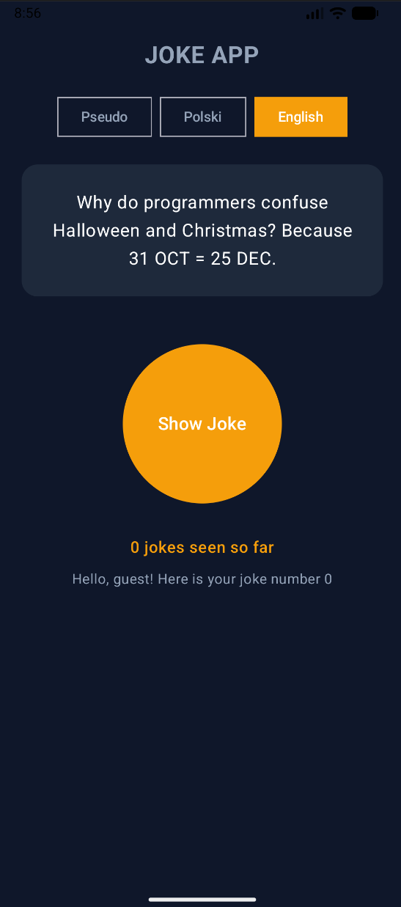
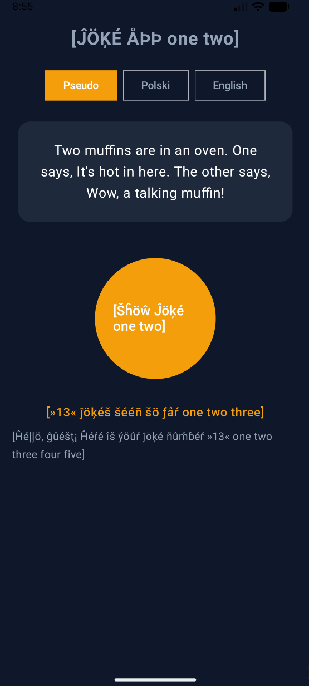

# Sprawozdanie z Laboratorium – Aplikacja "Joke App"

Niniejsze sprawozdanie przedstawia realizację aplikacji mobilnej stworzonej w technologii **Jetpack Compose**, skupiającej się na lokalizacjach (obsłudze wielu języków, w tym pseudojęzyka), liczbach mnogich oraz dynamicznej zmianie interfejsu.

---

## 1. Zrzuty ekranu: Wersja polska i angielska

Poniżej przedstawiono porównanie interfejsu aplikacji w języku polskim oraz angielskim.

| Wersja Polska (`pl`) | Wersja Angielska (`en`) |
| :---: | :---: |
|  |  |

---

## 2. Obsługa liczb mnogich (Plurals) w języku polskim

W języku polskim odmiana liczebników jest złożona. Angielski rozróżnia zazwyczaj tylko formę pojedynczą (`one`) i mnogą (`other`), co w języku polskim jest niewystarczające[cite: 6]. 

W plikach zasobów (`strings.xml`) zastosowano pełne reguły liczby mnogiej dla języka polskiego:
* **`one`** (np. *1 żart*) – dla liczby 1.
* **`few`** (np. *2, 3, 4 żarty*) – dla liczb kończących się na 2, 3, 4 (z wyjątkiem nastolatek).
* **`many`** (np. *0, 5, 6, 11, 22 żartów*) – dla liczby 0, liczb kończących się na 0, 1, 5-9 oraz nastolatek (11-14).
* **`other`** – dla pozostałych przypadków (np. ułamki).

Poniższe zrzuty ekranu prezentują działanie licznika w różnych formach fleksyjnych („żartów” vs „żarty”):

| Forma „żartów” (np. 6) | Forma „żarty” (np. 3) |
| :---: | :---: |
|  |  |

---

## 3. Testowanie w pseudojęzyku (Pseudo-locale `en-XA`)

Pseudojęzyk (`en-XA`) służy do testowania aplikacji pod kątem tzw. **pseudolokalizacji**. Pozwala on szybko wykryć błędy w kodzie i interfejsie jeszcze przed faktycznym tłumaczeniem tekstu na inne języki.

### Zrzut ekranu z pseudojęzyka

### Lista poprawek i problemów wykrytych dzięki pseudojęzykowi:
1. **Problemy z długością tekstu (Expansion):** Teksty w pseudojęzyku są sztucznie wydłużane. Pozwoliło to zauważyć, że niektóre etykiety na przyciskach oraz nagłówki mogłyby się uciąć na mniejszych ekranach, co wymusiło poprawę elastyczności layoutu (np. użycie odpowiednich modyfikatorów `Modifier.weight` lub zawijania linii).
2. **Problemy z kodowaniem znaków (Diakrytyki):** Zastąpienie standardowych liter akcentowanymi znakami diakrytycznymi pomogło upewnić się, że aplikacja poprawnie obsługuje niestandardowe znaki (UTF-8) i nie wyrzuca błędów kodowania (np. krzaków zamiast znaków specjalnych).
3. **Zasoby nieprzetłumaczone:** Wskazał elementy w kodzie lub plikach stringów, które były na sztywno zahardkodowane w kodzie źródłowym zamiast pobierać się z zasobów `strings.xml`.

---

## 4. Wyjaśnienie: Dlaczego standardowy warunek liczby pojedynczej jest niewystarczający w języku polskim?

W językach takich jak angielski występuje prosty podział binarny:
* `one`: dokładnie 1 element,
* `other`: wszystko inne (0, 2, 3, 105, itp.).

W języku polskim gramatyka jest znacznie bardziej skomplikowana. Liczba `1` wymaga formy pojedynczej, liczby kończące się na `2, 3, 4` (poza 12, 13, 14) wymagają formy dopełniacza liczby pojedynczej (*2 żarty*), natomiast liczby zakończone na `0, 5-9` oraz nastolatki (`11-14`) wymagają formy dopełniacza liczby mnogiej (*5 żartów*, *11 żartów*). Z tego powodu system oparty wyłącznie na warunku "1 kontra reszta" powodowałby błędy stylistyczne i gramatyczne (np. *"5 żart"* lub *"1 żarty"*). Mechanizm Android `plurals` z regułami `one`, `few`, `many` rozwiązuje ten problem.

---

## 5. Który zestaw zasobów powinien być domyślny i dlaczego?

**Domyślnym zestawem zasobów (w folderu `values/strings.xml`) powinien być język angielski (`en`).**

**Uzasadnienie:**
* **Uniwersalność:** W świecie IT i programowania angielski jest standardem globalnym. Jeśli aplikację pobierze użytkownik z kraju, którego języka aplikacja nie wspiera (np. Hiszpania, Niemcy), system operacyjny automatycznie fallbackuje (wraca) do zasobów domyślnych (`values/`), a nie do języka polskiego.
* **Standardy platformy:** System Android oraz środowisko Android Studio domyślnie traktują folder `values/` (bez przyrostka) jako język angielski. Lokalizacja polska powinna znajdować się w osobnym folderze z sufiksem regionalnym (`values-pl/`).
